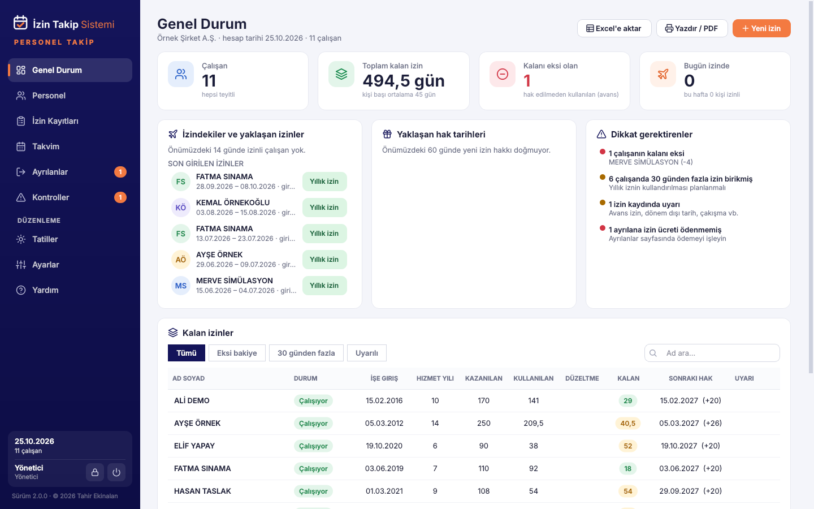
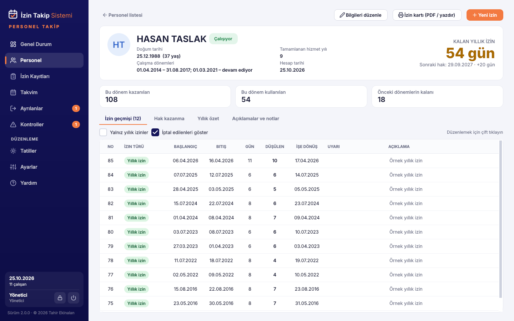
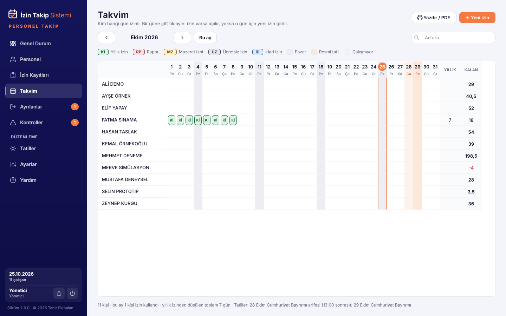

# İzin Takip Sistemi

Personelin yıllık izin hakkını, kullanımını ve kalan iznini takip eden küçük bir masaüstü programı (Windows; Python + PySide6).
Hesaplar 4857 sayılı İş Kanunu md.53–60 ve Yıllık Ücretli İzin Yönetmeliği'ne göre yapılır.

> **Durum: deneysel (v0.1.0).** Bir işyerindeki kendi ihtiyaç için, yapay zekâ yardımıyla yazıldı ve düzenlendi; ben (depo sahibi)
> profesyonel yazılımcı değilim. Hata ve eksik olabilir, bağımsız bir güvenlik ya da hukuk incelemesinden geçmedi. Gerçek personel verisiyle
> kullanmadan önce sonuçlarınızı mutlaka kendiniz kontrol edin. Geri bildirim, hata bildirimi ve düzeltmeler çok değerli.

Neler yapıyor:

- Kim ne kadar izin hak etti, ne kadarını kullandı, ne kadarı kaldı.
- İzin girişi (yıllık, rapor, mazeret, ücretsiz, idari), izin kartı, izin formu, aylık takvim.
- Kıdeme (14 / 20 / 26 gün) ve yaşa (18 altı, 50 üstü: en az 20 gün) göre hak ediş; Pazar ve resmî tatiller, arife yarım günleri,
  kesintili çalışma, ücretsiz izinle ötelenen hak tarihi, avans (hak edilmeden kullanılan) izin.
- İşten ayrılanın ödenmemiş izin ücreti (md.59) takibi.
- Otomatik kontroller: avans izin, çalışma dönemi dışı tarih, çakışan kayıt, Pazar / tatile yazılmış izin, eksik bilgi.
- Giriş (kullanıcı adı + parola), roller, şifreli veri dosyası ve yedek (AES-256-GCM), kurtarma anahtarı, otomatik kilit.
- PDF ve Excel çıktıları.



| İzin kartı | Takvim |
|---|---|
|  |  |

*Ekran görüntülerindeki kişiler ve izinler uydurmadır (`izin_takip/ornek_veri.py`).*

> **Kişisel veri uyarısı.** Bu depoda hiçbir gerçek kişi ya da işyeri verisi yoktur; program ilk açılışta isteğe bağlı olarak
> **uydurma örnek veri** yükler. Kendi personel verilerinizi bu depoya (issue, PR, ekran görüntüsü dâhil) **koymayın**
> (KVKK). Veri dosyanız yalnızca kendi bilgisayarınızdaki veri klasöründe, şifreli olarak durur.

## Hızlı başlangıç

Python 3.9 – 3.13 gerekir.

```bash
git clone https://github.com/albatroshTR/izin_takip_sistemi.git
cd izin_takip_sistemi
python -m pip install -r gereksinimler.txt
python baslat.py
```

İlk açılışta yönetici hesabı oluşturursunuz, kurtarma anahtarınızı bir kâğıda yazarsınız; sonra **örnek veriyle** ya da **boş** başlarsınız.
Windows'ta Python kuruluysa `calistir.bat`'a çift tıklamak yeterlidir; tek dosyalık `.exe` için `derle.bat` (ya da GitHub Actions
çıktısı) kullanılır. Ayrıntı: [docs/KULLANIM.md](docs/KULLANIM.md).

Pencere açmadan denemek için:

```bash
export IZIN_TAKIP_KULLANICI=deneme IZIN_TAKIP_PAROLA=Deneme-parola1
python baslat.py --veri ./deneme-verisi --ornek-veri      # şifreli veri dosyası + örnek veri
python baslat.py --veri ./deneme-verisi --deneme          # açar, hesaplar, özet yazar
```

## Testler

```bash
python testler/test_hesapla.py                              # hak ediş motoru (birim testleri)
QT_QPA_PLATFORM=offscreen python testler/test_uygulama.py   # uçtan uca + güvenlik (pencereler görünmeden)
```

## Yapı

```
baslat.py                  giriş noktası
izin_takip/
  hesapla.py               saf hesap motoru (KURAL sözlüğü: hak ediş, düşülen gün, avans, kalanın kaynağı)
  motor.py                 veriden kişi / kayıt sonuçları, kontroller
  veritabani.py            bellekte SQLite, kullanıcılar, işlem günlüğü, şifreli yedek
  guvenlik.py              şifreli dosya biçimi (AES-256-GCM, scrypt), parola / kurtarma anahtarı
  ornek_veri.py            uydurma örnek veri
  raporlar.py, disa_aktar.py   PDF ve Excel çıktıları
  arayuz/                  PySide6 pencereleri
  kaynaklar/               logo, simge, yazı tipi (Inter, SIL OFL), resmî tatiller (2019–2030)
testler/                   birim ve uçtan uca testler
docs/                      kullanım kılavuzu, hesap kuralları, resmî tatiller
```

## Hukuki not

Hesaplar yukarıdaki mevzuata göre yapılmaya çalışılır, ancak yanlış olabilir; program hukuki ya da mali müşavirlik hizmeti değildir. İş sözleşmeniz, toplu iş
sözleşmeniz ve işyeri uygulamanız kanundan farklı (işçi lehine) hükümler içerebilir; kesin sonuçlar için uzmanınıza danışın.
Resmî tatil listesindeki dinî bayram tarihleri Diyanet takviminden alınmıştır; her yıl başında kontrol edip güncelleyin.

## Katkı ve lisans

Katkılar için [CONTRIBUTING.md](CONTRIBUTING.md), güvenlik bildirimleri için [SECURITY.md](SECURITY.md). Lisans: [MIT](LICENSE).
